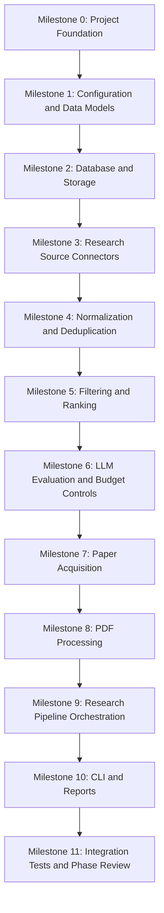

# QuantForge — Development Roadmap

**Document:** `ROADMAP.md`  
**Project:** QuantForge  
**Current focus:** Research discovery, evaluation, acquisition, and document processing  
**Status:** Initial roadmap — Research phase

---

## 1. Roadmap Purpose

This roadmap defines the implementation sequence for QuantForge. It translates the initial project specification into manageable milestones, with clear objectives, deliverables, and completion criteria.

The roadmap is intentionally limited to the **Research Phase**. Strategy extraction, implementation, backtesting, validation, paper trading, and live deployment will be planned after the research foundation is working and its requirements are clarified.

### Development principles

- Build in small, verifiable milestones.
- Complete and test foundational services before integrating them into a pipeline.
- Keep configuration separate from source code.
- Persist research records and processing states.
- Make pipeline operations repeatable and safe to rerun.
- Use deterministic code for filtering, scoring, deduplication, and document processing.
- Use LLM calls only when they provide meaningful value, with strict budget controls.
- Do not build a dashboard before the CLI and services are stable.
- Do not add MCP or autonomous agent workflows before the underlying services are reliable.

---

## 2. Research Phase Overview

<text></text>



Milestones may be adjusted when implementation reveals dependencies or technical constraints. Any material change should be reflected in this roadmap.

---

## 3. Milestones

## Milestone 0 — Project Foundation

### Objective
Create a clean, maintainable repository and a reliable development environment.

### Tasks

- [ ] Create the QuantForge repository.
- [ ] Create and document the Python virtual environment setup.
- [ ] Add `pyproject.toml` with project metadata and dependencies.
- [ ] Define the initial source, test, configuration, and data directories.
- [ ] Add `.gitignore` for virtual environments, secrets, caches, local data, and generated artifacts.
- [ ] Add `.env.example` with placeholder environment variables only.
- [ ] Configure basic logging.
- [ ] Add a minimal package entry point.
- [ ] Add pytest and verify a basic test runs.
- [ ] Add initial developer setup instructions to `README.md`.

### Deliverables

- A working Python project.
- Reproducible local setup instructions.
- Basic test and logging infrastructure.

### Exit criteria

A new development environment can install the project and run its tests without relying on undocumented local setup.

---

## Milestone 1 — Configuration and Data Models

### Objective
Define the shared configuration and metadata structures used throughout the research pipeline.

### Tasks

- [ ] Create typed configuration models.
- [ ] Define environment-variable handling for secrets and connection strings.
- [ ] Create `config/research_topics.yaml`.
- [ ] Create `config/research_pipeline.yaml`.
- [ ] Create `config/llm.yaml` without storing API keys.
- [ ] Define a common research-paper metadata model using Pydantic.
- [ ] Define source identifiers and source-reference structures.
- [ ] Define research states and allowed state transitions.
- [ ] Define evaluation score models and evidence/rationale fields.
- [ ] Define acquisition and document-processing status models.
- [ ] Validate configuration on application startup.
- [ ] Add tests for valid and invalid configuration and model inputs.

### Initial configuration categories

`research_topics.yaml`:

- Topic names and descriptions.
- Search terms and aliases.
- Research categories.
- Optional topic-specific filters.

`research_pipeline.yaml`:

- Discovery schedule settings.
- Search windows and result limits.
- Candidate thresholds.
- Weekly and monthly acquisition limits.
- Acquisition approval mode.
- Retry and timeout settings.
- Storage paths.

`llm.yaml`:

- Provider and model selection.
- Enable/disable switches for LLM tasks.
- Token limits.
- Per-task and per-paper call limits.
- Concurrency and retry limits.
- Budget thresholds.

### Deliverables

- Validated configuration system.
- Shared research metadata and status models.
- Configurable topic taxonomy.

### Exit criteria

Configuration can be loaded and validated, and source-independent research records can be created and serialized consistently.

---

## Milestone 2 — Database and Storage

### Objective
Persist research metadata, source references, scores, state history, and document locations.

### Tasks

- [ ] Define the initial PostgreSQL schema.
- [ ] Create database migration tooling.
- [ ] Create research-paper repository operations.
- [ ] Store normalized paper metadata.
- [ ] Store multiple source references for a single paper.
- [ ] Store evaluation scores and evaluation history.
- [ ] Store acquisition and processing status.
- [ ] Store state-transition history and error details.
- [ ] Store file paths, hashes, and document metadata.
- [ ] Add transaction boundaries and uniqueness constraints.
- [ ] Add database health checks.
- [ ] Add repository tests.

### Initial conceptual entities

- `research_papers`
- `paper_sources`
- `paper_evaluations`
- `paper_state_history`
- `paper_files`

The final schema and relationships should be documented in a separate `DATA_MODEL.md` before or during implementation.

### Deliverables

- PostgreSQL schema and migrations.
- Repository layer.
- Persistent research records and history.

### Exit criteria

A research record can be created, retrieved, updated, and linked to multiple sources and document artifacts without creating duplicate canonical records.

---

## Milestone 3 — Research Source Connectors

### Objective
Retrieve research metadata from initial sources through a consistent connector interface.

### Tasks

- [ ] Define a common research-source connector interface.
- [ ] Implement the arXiv connector.
- [ ] Implement the OpenAlex connector.
- [ ] Implement Crossref metadata lookup.
- [ ] Investigate and implement permitted SSRN discovery workflows.
- [ ] Support configurable search terms, date ranges, and result limits.
- [ ] Normalize source-specific responses into shared metadata models.
- [ ] Handle pagination.
- [ ] Handle rate limits, timeouts, and transient errors.
- [ ] Record source provenance and retrieval timestamps.
- [ ] Add connector-level tests using fixtures and mocked responses.
- [ ] Add integration tests that make limited real API requests when explicitly enabled.

### Connector design requirements

- One connector should not dictate the entire pipeline's data model.
- Source-specific fields should be preserved where useful.
- Missing metadata should remain missing rather than being fabricated.
- Access restrictions must be respected.
- API credentials, where required, must be read from environment variables or secure configuration.

### Deliverables

- Source connector interface.
- Initial metadata connectors.
- Normalized source results.

### Exit criteria

A user can search supported sources and receive normalized research records with source identifiers and provenance.

---

## Milestone 4 — Normalization and Deduplication

### Objective
Merge records referring to the same paper while preserving all source references.

### Tasks

- [x] Normalize titles for comparison.
- [x] Normalize DOI values.
- [x] Normalize arXiv identifiers.
- [x] Implement identifier-based duplicate detection.
- [x] Implement normalized-title fallback matching.
- [x] Define conflict-resolution rules for metadata fields.
- [x] Preserve alternate source metadata and links.
- [x] Assign a stable internal paper ID.
- [x] Add duplicate-match explanations or match evidence.
- [x] Add tests for exact matches, near matches, missing identifiers, and collisions.

### Deliverables

- Metadata normalization service.
- Deduplication service.
- Stable canonical paper records.

### Exit criteria

Repeated discovery runs do not create duplicate canonical papers, and multiple source records remain traceable to one paper.

---

## Milestone 5 — Candidate Filtering and Ranking

### Objective
Reduce large discovery results to a manageable, explainable research shortlist.

### Tasks

- [x] Implement metadata-based filters.
- [x] Implement configurable keyword/topic matching.
- [x] Implement date and publication-status filters.
- [x] Implement relevance scoring.
- [x] Implement credibility assessment fields and rules.
- [x] Implement implementability assessment fields.
- [x] Implement reproducibility assessment fields.
- [x] Define configurable research-priority calculation.
- [x] Store individual scores, evidence, and scoring version.
- [x] Support sorting and filtering by score and topic.
- [x] Add tests for score calculations and filter behavior.

### Scoring principles

- Keep component scores separate.
- Make scoring rules configurable and versioned.
- Do not treat citation count as a direct quality score.
- Clearly distinguish rule-based scores from LLM assessments.
- Avoid false precision: scores should support prioritization, not claim scientific certainty.

### Deliverables

- Candidate filtering service.
- Explainable scoring and ranking.
- Research shortlist.

### Exit criteria

Candidates can be filtered and ranked reproducibly, and the reason for a paper's priority can be inspected.

---

## Milestone 6 — LLM Evaluation and Budget Controls

### Objective
Use an LLM selectively to evaluate shortlisted papers and manage all LLM usage centrally.

### Tasks

- [ ] Define an LLM provider interface.
- [ ] Implement the initial OpenRouter adapter.
- [ ] Define structured output schemas for paper evaluation.
- [ ] Create prompts for relevance, implementability, and methodology-quality evaluation.
- [ ] Restrict evaluation input to relevant metadata and text excerpts where possible.
- [ ] Require evidence or rationale for substantive assessments.
- [ ] Validate model output against schemas.
- [ ] Implement centralized usage logging.
- [ ] Implement budget reservation before requests.
- [ ] Implement request, task, and per-paper call limits.
- [ ] Implement input/output token limits.
- [ ] Implement concurrency and retry controls.
- [ ] Implement budget-stop behavior.
- [ ] Ensure no automatic credit recharge is initiated by QuantForge.
- [ ] Add mocked tests for provider failures, invalid output, and budget exhaustion.
- [ ] Add a small, manually enabled end-to-end LLM test.

### Deliverables

- LLM service abstraction.
- Structured evaluation results.
- Central budget and usage manager.
- Cost and usage reports.

### Exit criteria

LLM evaluation can be enabled or disabled through configuration, every request is logged, and configured budget limits prevent additional requests when exhausted.

---

## Milestone 7 — Paper Acquisition

### Objective
Acquire prioritized papers from permitted sources within configurable limits.

### Tasks

- [x] Define a paper-file resolver interface.
- [x] Resolve permitted full-text locations.
- [x] Implement arXiv PDF acquisition.
- [x] Implement permitted OpenAlex open-access location handling.
- [x] Implement permitted SSRN or repository acquisition where technically and legally available.
- [x] Validate content type and PDF structure.
- [x] Detect incomplete or invalid downloads.
- [x] Calculate SHA-256 hashes.
- [x] Use safe temporary files and atomic file placement.
- [x] Avoid downloading an already acquired identical file.
- [x] Enforce weekly and monthly acquisition limits.
- [x] Support manual approval and configured automatic acquisition.
- [x] Record source URL, acquisition time, hash, size, and outcome.
- [x] Add retry handling and acquisition tests.

### Deliverables

- Paper resolver and downloader.
- Acquisition policy and limits.
- Validated PDF artifacts with provenance.

### Exit criteria

A ranked paper can be acquired, validated, stored, and linked to its research record; failed or unavailable acquisition is recorded clearly.

---

## Milestone 8 — PDF and Document Processing

### Objective
Convert acquired PDFs into usable research text and document structure.

### Tasks

- [x] Implement PDF text extraction using PyMuPDF.
- [x] Preserve page boundaries and page references.
- [x] Detect extraction failures or suspiciously empty output.
- [x] Implement basic section-heading detection.
- [x] Store extracted text.
- [x] Store section structure in JSON.
- [x] Evaluate table extraction with pdfplumber where useful.
- [x] Preserve figure references and page locations.
- [x] Record processing version and extraction metadata.
- [x] Implement idempotent processing.
- [x] Add document-processing tests using sample PDFs.
- [x] Create a Research Document Package.

### Research Document Package

```text
research_library/
└── <paper_id>/
    ├── metadata.json
    ├── paper.pdf
    ├── text.txt
    ├── sections.json
    ├── tables/
    ├── figures/
    └── acquisition.json
```

Optional artifacts may be absent if extraction is unsupported or unnecessary.

### Deliverables

- PDF text extraction.
- Section extraction.
- Document validation.
- Research Document Package.

### Exit criteria

An acquired paper can be processed into a package containing its original PDF, metadata, extracted text, section structure where possible, and processing history.

---

## Milestone 9 — Research Pipeline Orchestration

### Objective
Connect individual research services into a controlled, resumable pipeline.

### Tasks

- [ ] Implement pipeline orchestration.
- [ ] Define valid state transitions.
- [ ] Support on-demand pipeline execution.
- [ ] Support resuming from the last successful stage.
- [ ] Prevent duplicate work where possible.
- [ ] Record stage start/end times.
- [ ] Record failures, retries, and error details.
- [ ] Implement per-stage retry policies.
- [ ] Ensure database and filesystem operations remain consistent.
- [ ] Add pipeline-level tests.
- [ ] Add a dry-run mode for acquisition and LLM evaluation.

### Deliverables

- Research pipeline orchestrator.
- State manager.
- Resumable processing and error handling.

### Exit criteria

A batch of discovered papers can move through the pipeline, failed papers can be inspected and retried, and successful work is not needlessly repeated.

---

## Milestone 10 — CLI and Research Reports

### Objective
Provide a practical command-line interface for operating and inspecting the research pipeline.

### Initial command concepts

Exact command names may be finalized during implementation. Expected capabilities include:

```text
quantforge research search
quantforge research evaluate
quantforge research rank
quantforge research acquire
quantforge research process
quantforge research status
quantforge research report
```

### Tasks

- [ ] Define CLI command conventions.
- [ ] Implement on-demand discovery.
- [ ] Implement candidate evaluation and ranking commands.
- [ ] Implement acquisition and processing commands.
- [ ] Implement status and inspection commands.
- [ ] Implement concise research reports.
- [ ] Support filters such as topic, date, source, score, and state.
- [ ] Provide useful progress and error messages.
- [ ] Support JSON output where useful for automation.
- [ ] Document commands and examples.

### Deliverables

- CLI for research operations.
- Research shortlist and pipeline status reports.
- CLI documentation.

### Exit criteria

The research phase can be operated and inspected without a dashboard or direct database manipulation.

---

## Milestone 11 — Integration Tests and Research Phase Review

### Objective
Verify the complete research workflow and assess readiness for the next phase.

### Tasks

- [ ] Test discovery across supported connectors.
- [ ] Test normalization and deduplication.
- [ ] Test candidate filtering and ranking.
- [ ] Test LLM evaluation with mocked and limited real requests.
- [ ] Test budget exhaustion and stop behavior.
- [ ] Test paper acquisition and file validation.
- [ ] Test PDF processing and package creation.
- [ ] Test pipeline resumption and failure recovery.
- [ ] Test CLI workflows.
- [ ] Review logging, configuration, and error messages.
- [ ] Review database constraints and data integrity.
- [ ] Review access compliance for all acquisition paths.
- [ ] Document known limitations.
- [ ] Update `PROJECT_SPEC.md` and `ROADMAP.md` based on implementation findings.

### Research Phase Completion Gate

The research phase is complete when:

- [ ] On-demand discovery works.
- [ ] Scheduled discovery can be configured and run.
- [ ] Source metadata is normalized and deduplicated.
- [ ] Candidate evaluation and ranking are explainable and persisted.
- [ ] Acquisition limits are enforced.
- [ ] Permitted paper files can be acquired and validated.
- [ ] PDFs can be processed into Research Document Packages.
- [ ] Research states, failures, and retries are recorded.
- [ ] LLM usage is centrally controlled and logged.
- [ ] CLI workflows are documented and tested.
- [ ] A small end-to-end research batch completes successfully.
- [ ] Known limitations and next-phase requirements are documented.

---

## 4. Proposed Repository Structure

This is an initial structure proposal. It can be adjusted as implementation details become clearer.

```text
QuantForge/
├── PROJECT_SPEC.md
├── ROADMAP.md
├── README.md
├── AGENTS.md
├── pyproject.toml
├── .env.example
├── .gitignore
│
├── config/
│   ├── research_topics.yaml
│   ├── research_pipeline.yaml
│   └── llm.yaml
│
├── src/
│   └── quantforge/
│       ├── __init__.py
│       ├── cli/
│       ├── config/
│       ├── database/
│       ├── models/
│       ├── research/
│       │   ├── discovery/
│       │   ├── normalization/
│       │   ├── filtering/
│       │   ├── evaluation/
│       │   ├── acquisition/
│       │   ├── processing/
│       │   ├── storage/
│       │   └── pipeline/
│       ├── llm/
│       │   ├── providers/
│       │   ├── budget/
│       │   └── prompts/
│       └── common/
│           ├── logging/
│           └── errors/
│
├── tests/
│   ├── unit/
│   ├── integration/
│   └── fixtures/
│
├── research_library/        # Local paper artifacts; normally git-ignored
├── logs/                    # Local logs; normally git-ignored
└── scripts/
```

Do not create every directory in advance merely to match this tree. Add modules when their milestone begins.

---

## 5. Suggested Implementation Order

The dependency-aware order is:

1. Project setup and tests.
2. Configuration and shared models.
3. Database schema and repository.
4. One source connector end-to-end (preferably arXiv).
5. Normalization and deduplication.
6. Additional source connectors.
7. Filtering and ranking.
8. LLM evaluation and budget manager.
9. Paper acquisition.
10. PDF processing.
11. Pipeline orchestration.
12. CLI commands and reports.
13. Integration testing and phase review.

**Recommended vertical slice:** Before implementing every connector, make one paper flow from discovery → normalization → database persistence → acquisition → PDF extraction → CLI inspection. Then expand sources and evaluation capabilities.

---

## 6. Work Tracking Rules

For implementation tracking:

- Use milestone checklists in this file for high-level progress.
- Keep detailed task-level progress in GitHub Issues, a project tracker, or a separate task document.
- Mark a task complete only after its acceptance criteria and relevant tests pass.
- Record blockers and important decisions.
- Avoid marking an entire milestone complete when only its happy path works.
- Update the roadmap when scope or implementation order changes.

A milestone is complete only when its deliverables exist, its exit criteria are satisfied, and relevant tests pass.

---

## 7. Current Status and Next Action

### Current status

- [x] Project intent and initial research scope captured in `PROJECT_SPEC.md`.
- [x] Initial research-phase roadmap drafted.
- [x] Repository foundation implemented.
- [ ] Configuration and metadata models implemented.
- [ ] Database schema implemented.
- [ ] Research pipeline implemented.

### Next action

Begin **Milestone 0 — Project Foundation** by finalizing the repository setup, Python packaging, environment, tests, and README instructions. Then proceed to configuration and shared research models.
