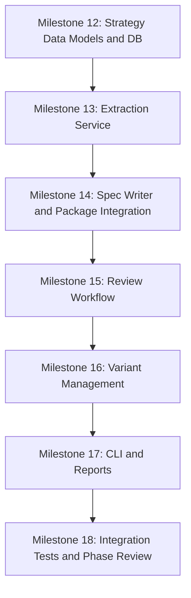

# QuantForge — Strategy Engineering Roadmap

**Document:** `ROADMAP_STRATEGY_ENGINEERING.md`
**Phase:** Strategy Engineering
**Depends on:** Research Phase complete (M0–M11 all passed)
**Status:** Draft

---

## 1. Phase Purpose

The Strategy Engineering phase reads Research Document Packages produced by the Research Phase and extracts structured, machine-readable Strategy Specifications from them.

The output of this phase is not executable code and not a backtest configuration. It is a provenance-tracked, human-reviewed record of what each paper says about how to trade — using the schema defined in `STRATEGY_SCHEMA.md`.

No strategy is considered ready for backtesting until it has an approved base specification.

---

## 2. Phase Principles

- Extract only what the paper says. Record missing components honestly.
- Every rule must have a provenance label. No exceptions.
- LLM extraction must be human-reviewed before a spec is approved.
- Use `sections.json` for targeted extraction — never send the full paper text.
- Three focused LLM calls per paper: routing, extraction, validation.
- All LLM calls go through the existing budget manager.
- Missing pillars are recorded, not invented.
- `quantforge_added` rules belong in named variants only, never the base spec.
- No UI. CLI is the interface throughout this phase.
- No MCP. Services are built first; exposure comes later.

---

## 3. Phase Overview



---

## 4. Milestones

---

## Milestone 12 — Strategy Data Models and Database

### Objective
Define the data structures and persistence layer for Strategy Specifications before any extraction code is written.

### Tasks

- [x] Define the `StrategySpecification` Pydantic model matching `STRATEGY_SCHEMA.md`.
- [x] Define the `RuleObject` model with required and optional fields as per the schema.
- [x] Define the `MissingComponent` model.
- [x] Define the `MethodologyAssessment` model.
- [x] Define the `StrategyVariant` model.
- [x] Define strategy status enum: `draft | under_review | approved | rejected | superseded`.
- [x] Define completeness classification enum from the schema.
- [x] Define provenance label enum: `explicit | inferred | quantforge_added`.
- [x] Add `strategy_specifications` table migration.
- [x] Add repository operations: create, get by paper_id, update status, list by status, list by paper.
- [x] Add uniqueness constraint: one base spec per paper per version.
- [x] Add tests for models, state transitions, and repository operations.
- [x] Update `DATA_MODEL.md` with the new table and relationships.

### New database table

```
strategy_specifications:
  strategy_id        UUID, primary key
  paper_id           Foreign key to research_papers
  version            Integer
  variant            String, default "base"
  status             draft | under_review | approved | rejected | superseded
  completeness_class String
  file_path          Path to spec JSON on disk
  extracted_by       String
  reviewed_by        String, nullable
  created_at         Timestamp
  updated_at         Timestamp
```

### Deliverables

- Strategy Specification models.
- Database migration and repository layer.
- Updated data model documentation.

### Exit criteria

A strategy specification record can be created, retrieved, updated, and linked to a paper without touching the extraction logic.

---

## Milestone 13 — LLM Extraction Service

### Objective
Build the three-call LLM extraction pipeline that produces raw rule objects from a Research Document Package.

### Tasks

- [ ] Implement Call 1 — Section Router.
  - Input: section titles from `sections.json` + abstract from `metadata.json`.
  - Output: mapping of pillar names to relevant section indices, plus `not_found` list.
  - Token budget: configurable, default 1,000.
- [ ] Implement Call 2 — Pillar Extractor.
  - Group pillars into logical extraction groups (Entry/Exit/Regime, Sizing/Risk/Portfolio, Asset Selection, Backtesting).
  - Send only sections identified by the router.
  - Output: structured rule objects per pillar matching the schema.
  - Token budget per group: configurable, default 6,000.
- [ ] Implement Call 3 — Validation and Assessment.
  - Input: all extracted rule objects + missing component list from Call 1.
  - Output: completeness classification, methodology assessment, flagged rules.
  - **Cross-pillar leakage check:** Call 3 must explicitly check for rules that belong in one pillar but were placed in another (e.g. exit rules inside the entry pillar, sizing rules inside risk management). Flag each leakage case with the pillar it should move to.
  - Token budget: configurable, default 3,000.
- [ ] Add fallback: if `sections.json` has no headings, chunk `text.txt` with a logged warning.
- [ ] Add section quality filter: before the routing call, exclude sections whose `content` length is below `min_section_chars` (configurable in `config/strategy.json`, default 200). Record excluded section indices in the extraction audit. If all sections are filtered, fall back to `text.txt` chunking and log a warning. See `STRATEGY_SCHEMA.md` Section 9.2.
- [ ] Write excluded section indices to `extraction_audit.sections_filtered_too_short`.
- [ ] Add section size guard: if a section exceeds the token budget, split it and merge results.
- [ ] Route all calls through the existing LLM service and budget manager.
- [ ] Handle malformed JSON responses: retry once, then mark as `extraction_failed`.
- [ ] Handle mid-paper budget exhaustion: save partial spec as draft, record which pillars completed.
- [ ] Add prompt templates for all three calls under `llm/prompts/strategy/`.
- [ ] Add worked example from `STRATEGY_SCHEMA.md` Section 14 to the extraction prompts.
- [ ] Add `strategy_extraction` section to `config/llm.json` under a `strategy_extraction` key with per-call token budgets and total per-paper budget. Do **not** put model selection in `config/strategy.json` — keep it in `config/llm.json` consistent with the research phase. `config/strategy.json` holds extraction behaviour (token budgets, section filter thresholds, fallback flags) only.
- [ ] Add `extraction_audit` block to every spec file — routing map, sections used/skipped/filtered, total token counts, extraction date. See `STRATEGY_SCHEMA.md` Section 9.1.
- [ ] Add unit tests with mocked LLM responses for all three calls.
- [ ] Add tests for fallback, section splitting, budget exhaustion, and malformed response handling.

### Prompt design requirements

- Call 1 prompt must instruct the LLM to return only JSON. No preamble.
- Call 2 prompt must include the relevant pillar definitions from the schema and the worked example.
- Call 2 prompt must instruct the LLM to omit optional rule fields when the paper provides nothing for them — not to write null or placeholder values.
- Call 3 prompt must instruct the LLM to flag any rule labeled `explicit` that lacks a clear source reference.

### Deliverables

- Three-call extraction pipeline.
- Prompt templates.
- Extraction configuration.
- Unit tests with mocked responses.

### Exit criteria

Given a Research Document Package, the extraction service produces raw rule objects across all covered pillars, records absent pillars, and stays within the configured per-paper token budget.

---

## Milestone 14 — Spec Writer and Package Integration

### Objective
Take the raw output from the extraction service and write a valid, complete spec file to disk and a record to the database.

### Tasks

- [ ] Implement the spec writer service.
  - Validate all rule objects against the `RuleObject` model.
  - Check all required fields are present on every rule.
  - Assign `rule_id` values if not already assigned.
  - Build the `component_coverage` summary from extraction results.
  - Build the `missing_component` records for all absent or partial pillars.
  - Assemble the full `StrategySpecification` object.
  - Serialize to JSON and write to `research_library/<paper_id>/strategy/spec_v<N>.json`.
  - Create the `strategy/` subdirectory if it does not exist.
  - Write DB record with status `draft`.
- [ ] Implement version incrementing: if a spec already exists for this paper, increment version and supersede the previous one.
- [ ] Implement extraction metadata block: method, date, extractor notes.
- [ ] Add a deterministic post-extraction check:
  - Every rule has a provenance label.
  - Every `inferred` rule has an `evidence` field.
  - No `quantforge_added` rule appears in the base spec.
  - Raise a clear error if any check fails — do not silently save a broken spec.
- [ ] Add tests for spec assembly, file writing, version incrementing, and all post-extraction checks.

### Deliverables

- Spec writer service.
- Deterministic post-extraction validation.
- Spec file written to Research Document Package.
- DB record created.

### Exit criteria

A complete, valid spec file exists on disk and in the database for a processed paper, with status `draft` and all provenance checks passing.

---

## Milestone 15 — Review Workflow

### Objective
Allow a human reviewer to inspect, approve, or reject a spec through the CLI. No spec moves to `approved` without passing the review checklist.

### Tasks

- [ ] Implement review service with the six-point checklist from `STRATEGY_SCHEMA.md` Section 11.
- [ ] Implement `approve_spec(strategy_id, reviewer_id)` — sets status to `approved`, records reviewer.
- [ ] Implement `reject_spec(strategy_id, reviewer_id, notes)` — sets status to `rejected`, records reason.
- [ ] Implement `list_specs_pending_review()` — returns all specs with status `under_review`.
- [ ] Implement `get_spec_review_summary(strategy_id)` — returns the spec with flagged rules highlighted.
- [ ] Add CLI commands:
  - `quantforge strategy review list` — show all specs pending review.
  - `quantforge strategy review show <strategy_id>` — display spec with flagged items. Supports `--output-file <path>` to write a formatted Markdown review sheet (strongly recommended for specs with more than ~20 rules).
  - `quantforge strategy review approve <strategy_id>` — approve after checklist confirmation.
  - `quantforge strategy review reject <strategy_id>` — reject with required notes.
- [ ] Auto-transition spec status from `draft` to `under_review` when extraction completes without errors.
- [ ] Add tests for status transitions, checklist enforcement, and CLI commands.

### Deliverables

- Review service.
- CLI review commands.
- Status transition enforcement.

### Exit criteria

A spec cannot reach `approved` status without passing the six-point checklist. Rejected specs record the reason. The CLI surfaces all pending reviews clearly.

---

## Milestone 16 — Variant Management

### Objective
Allow `quantforge_added` rules to be tracked in named variants that extend the base spec without modifying it.

### Tasks

- [ ] Implement variant creation from an approved base spec.
  - Variant inherits all rules from the base.
  - Only `quantforge_added` rules may be added in a variant.
  - Variant records `based_on` strategy_id and version.
- [ ] Implement variant serialization to `strategy/variants/<variant_id>_v<N>.json`.
- [ ] Add DB support for variant records (variant field on `strategy_specifications`).
- [ ] Implement `list_variants(paper_id)` — returns all variants for a paper.
- [ ] Implement `get_variant(strategy_id, variant_id)`.
- [ ] Add CLI commands:
  - `quantforge strategy variant create <strategy_id> <variant_name>` — create a new variant.
  - `quantforge strategy variant list <paper_id>` — list all variants.
  - `quantforge strategy variant show <strategy_id>` — display a variant with additions highlighted.
- [ ] Add tests for variant creation, inheritance, and that base specs remain unmodified.

### Deliverables

- Variant management service.
- Variant CLI commands.
- Base spec immutability enforced.

### Exit criteria

A variant can be created from an approved base spec, its `quantforge_added` rules are clearly separated, and the base spec is not modified.

---

## Milestone 17 — CLI and Reports

### Objective
Provide a complete command-line interface for operating the strategy engineering workflow and inspecting its outputs.

### Initial commands

```text
quantforge strategy extract <paper_id>        — run extraction for one paper
quantforge strategy extract --batch           — run extraction for all approved research papers
quantforge strategy review list               — list specs pending review
quantforge strategy review show <id>          — show spec with flagged items
quantforge strategy review approve <id>       — approve a spec
quantforge strategy review reject <id>        — reject a spec with notes
quantforge strategy variant create <id>       — create a named variant
quantforge strategy variant list <paper_id>   — list variants for a paper
quantforge strategy status                    — summary of all specs by status
quantforge strategy report <paper_id>         — full spec report for one paper
quantforge strategy report --approved         — report of all approved base specs
```

### Tasks

- [ ] Implement `extract` command for single paper and batch mode.
- [ ] Implement `status` command — counts by status, flagged rules count, pending reviews.
- [ ] Implement `report` command — human-readable spec summary for one paper or all approved.
- [ ] Support JSON output flag for all commands where useful for automation.
- [ ] Provide clear progress and error messages during extraction.
- [ ] Document all commands with examples in `docs/strategy_cli.md`.
- [ ] Add tests for all CLI commands.

### Deliverables

- Complete strategy engineering CLI.
- Status and report commands.
- CLI documentation.

### Exit criteria

The strategy engineering workflow can be fully operated and inspected from the CLI without direct database access.

---

## Milestone 18 — Integration Tests and Phase Review

### Objective
Verify the complete strategy engineering workflow end-to-end and confirm readiness for the backtesting phase.

### Tasks

- [ ] Test extraction on at least three real approved Research Document Packages.
- [ ] Test section routing correctly identifies relevant sections.
- [ ] Test extraction correctly handles a paper with absent critical pillars.
- [ ] Test provenance checks catch violations before saving.
- [ ] Test budget exhaustion mid-extraction leaves a valid partial draft.
- [ ] Test fallback behavior when `sections.json` has no headings.
- [ ] Test review workflow: approve path and reject path.
- [ ] Test variant creation and base spec immutability.
- [ ] Test CLI commands end-to-end.
- [ ] Review prompt quality: do extracted specs accurately reflect the papers?
- [ ] Review token usage: is actual per-paper cost within the configured budget?
- [ ] Review DB constraints and data integrity.
- [ ] Document known limitations and prompt improvement notes.
- [ ] Update `PROJECT_SPEC.md`, this roadmap, and `STRATEGY_SCHEMA.md` based on findings.

### Strategy Engineering Phase Completion Gate

The phase is complete when:

- [ ] At least five papers have approved base specifications.
- [ ] All approved specs pass the six-point review checklist.
- [ ] No `quantforge_added` rule exists in any base spec.
- [ ] Missing components are recorded for all incomplete papers.
- [ ] Token usage per paper is within the configured budget.
- [ ] At least one variant exists demonstrating `quantforge_added` rule separation.
- [ ] CLI workflows are documented and tested.
- [ ] Known prompt limitations and next-phase requirements are documented.

---

## 5. Repository Structure Additions

Add these directories alongside the existing research structure:

```text
src/quantforge/
└── strategy/
    ├── __init__.py
    ├── models/           ← StrategySpecification, RuleObject, MissingComponent, etc.
    ├── extraction/       ← Three-call extraction pipeline
    ├── writer/           ← Spec writer and post-extraction validation
    ├── review/           ← Review workflow and checklist enforcement
    └── variants/         ← Variant management

config/
└── strategy.json         ← Extraction settings, token budgets, model selection

llm/prompts/strategy/
    ├── routing.txt
    ├── extraction_group_a.txt
    ├── extraction_group_b.txt
    ├── extraction_group_c.txt
    ├── extraction_group_d.txt
    └── validation.txt

docs/
└── strategy_cli.md
```

---

## 6. Configuration Additions

Add `config/strategy.json`:

```json
{
  "extraction": {
    "per_paper_budget_tokens": 20000,
    "min_section_chars": 200,
    "calls": {
      "routing": {
        "max_tokens": 1000
      },
      "extraction_per_group": {
        "max_tokens": 6000
      },
      "validation": {
        "max_tokens": 3000
      }
    },
    "fallback_to_full_text": true,
    "max_section_tokens": 5000
  },
  "review": {
    "require_human_approval": true,
    "auto_transition_to_under_review": true
  }
}
```

> **Note:** Model selection (`model`) is NOT in `config/strategy.json`. It lives in `config/llm.json` under a `strategy_extraction` key, consistent with how the research phase handles LLM configuration. If you upgrade the model, there is one place to change it.

Add `strategy_extraction` block to `config/llm.json`:

```json
"strategy_extraction": {
  "model": "anthropic/claude-sonnet-4-5",
  "enabled": true
}
```

---

## 7. What This Phase Does Not Include

- No backtesting. Strategy specs are inputs to the backtesting phase — not tested here.
- No performance claims. Pillar 9 records the paper's own backtest only.
- No UI or dashboard.
- No MCP server.
- No live or paper trading components.
- No signal generation.

---

## 8. Current Status and Next Action

### Current status

- [x] Research Phase complete through Milestone 8.
- [x] `STRATEGY_SCHEMA.md` drafted and approved.
- [ ] Research Phase Milestones 9–11 in progress.
- [ ] Strategy Engineering phase not yet started.

### Next action

Complete Research Phase Milestones 9–11. Once the Research Phase Completion Gate in Milestone 11 is passed, begin **Milestone 12 — Strategy Data Models and Database**.

> **Pre-phase corpus seeding (do before Milestone 12):**
> The phase gate requires 5 approved strategy specs, which means 5 papers must reach `PROCESSED` state with high enough scores. Given the current arXiv search returning off-topic results at low scores, do not rely on the discovery pipeline alone to populate the corpus. Before starting Milestone 12, manually run the pipeline with 10–15 targeted momentum and mean-reversion papers, manually approve the best 5–6 via `quantforge research acquire --paper-id <id>` and `quantforge research process`, and start Strategy Engineering with a known-good corpus. This avoids spending LLM budget on papers that will be rejected at review.
